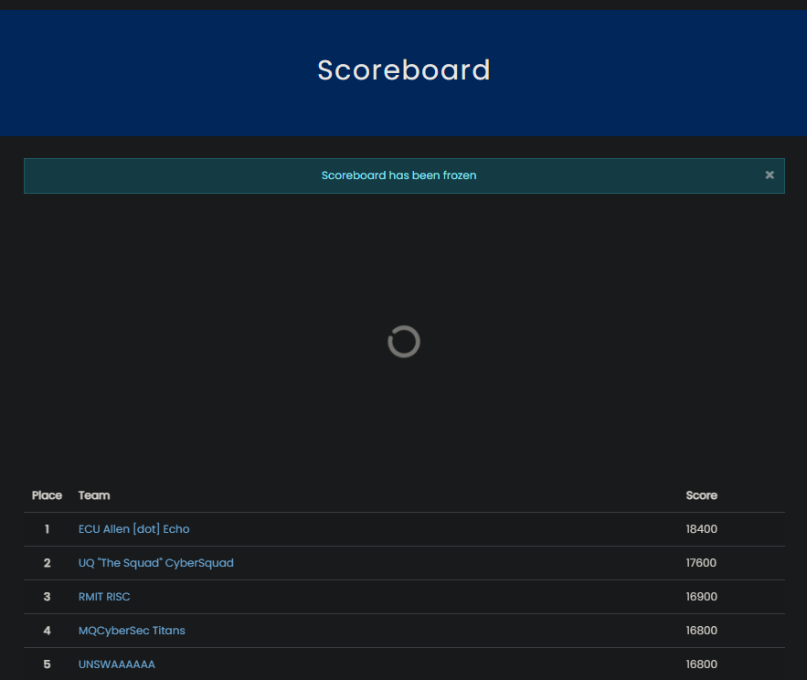

## Past Competitions

### [SRCTF 2026](SRCTF-2026/)
**Co-hosted by SWITCH, CSIT & RISC @ RMIT University**
- **Placement:** **1st Place** (*womeninstem* - 4,225 pts)
- **Team:** [Sadiq](https://www.linkedin.com/in/sadiq-quadri-71795a33b/) (`wallsdeep13`) & [Ibrahim](https://www.linkedin.com/in/ibrahim-hizamul-ansari-4809b226a/) (`sleepyswords`)
- **Domains:** Web Exploitation, Filter Smuggling, Authorization Bypasses, XXE, IDOR

### [CubeCTF 2025](CubeCTF-2025/)
**Annual Cybersecurity Competition**
- **Placement:** **19th Place** (*RMIT Computing* / *RMITC* - 2,997 pts)
- **Team:** [Sadiq](https://www.linkedin.com/in/sadiq-quadri-71795a33b/) (`wallsdeep13`) & [Ibrahim](https://www.linkedin.com/in/ibrahim-hizamul-ansari-4809b226a/) (`sleepyswords`)
- **Domains:** Web Exploitation, Reverse Engineering, Cryptography, Memory/Disk Forensics, Packet Analysis (PCAP), OSINT

### [GPNCTF 2025](GPNCTF-2025/)
**Goulash Programming Night CTF**
- **Placement:** **42nd Place** (*RMIT Computing* / *RMITC* - 772 pts)
- **Team:** [Sadiq](https://www.linkedin.com/in/sadiq-quadri-71795a33b/) (`wallsdeep13`) & [Ibrahim](https://www.linkedin.com/in/ibrahim-hizamul-ansari-4809b226a/) (`sleepyswords`)
- **Domains:** Web Exploitation, Reverse Engineering, Binary Exploitation (Pwn), Git Security (Misc)

### CTF@CIT 2025
**Annual Cybersecurity Competition**
- **Placement:** **29th Place** (*RMIT Computing* / *RMITC* - 25,285 pts)
- **Team:** [Sadiq](https://www.linkedin.com/in/sadiq-quadri-71795a33b/) (`wallsdeep13`) & [Ibrahim](https://www.linkedin.com/in/ibrahim-hizamul-ansari-4809b226a/) (`sleepyswords`)

### Google Capture The Flag 2025
**Google CTF 2025**
- **Placement:** **192nd Place** (*RMIT Computing* / *RMITC* - 126 pts)
- **Team:** [Sadiq](https://www.linkedin.com/in/sadiq-quadri-71795a33b/) (`wallsdeep13`) & [Ibrahim](https://www.linkedin.com/in/ibrahim-hizamul-ansari-4809b226a/) (`sleepyswords`)

### UMDCTF 2025
**University of Maryland CTF**
- **Placement:** **687th Place** (*RMIT Computing* / *RMITC* - 50 pts)
- **Team:** [Sadiq](https://www.linkedin.com/in/sadiq-quadri-71795a33b/) (`wallsdeep13`) & [Ibrahim](https://www.linkedin.com/in/ibrahim-hizamul-ansari-4809b226a/) (`sleepyswords`)

### Aust Cyber Security Games 2025
**Hosted by SECedu**
- **Placement:** **3rd Place** (*RMIT RISC* - 16,900 pts)
- **Team:** [Sadiq](https://www.linkedin.com/in/sadiq-quadri-71795a33b/) (`wallsdeep13`), [Ibrahim](https://www.linkedin.com/in/ibrahim-hizamul-ansari-4809b226a/) (`sleepyswords`) & `msimonelli`

---
## Random Writeups
## Featured Writeups

> [!info] Navigation & Terminal
> - Use the **interactive terminal** in the right sidebar / on the bottom of the screen to browse writeups directly (`ls`, `1`-`9`, `open <name>`).
> - Press `Ctrl + K` on PC to search writeups by tag, keyword, or payload.